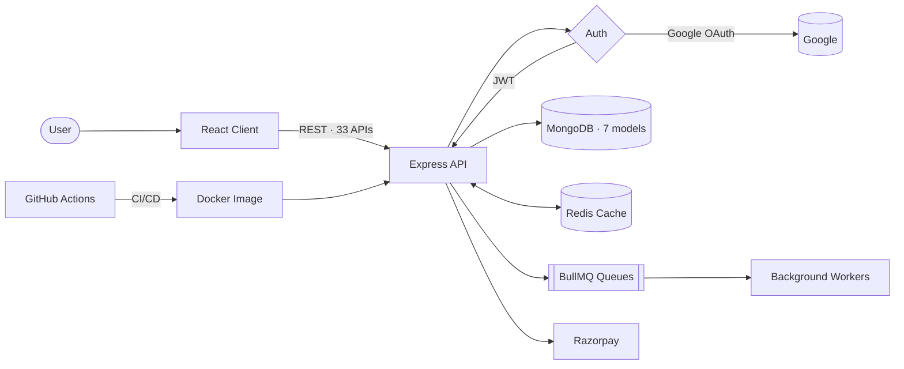
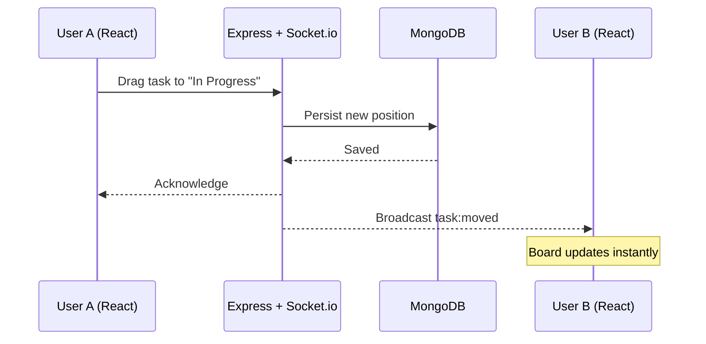

<div align="center">


<a href="https://github.com/gulammustafa01">
  
</a>

<br/><br/>

<a href="https://www.linkedin.com/in/gulam-e-mustafa-134b912a3"></a>
<a href="mailto:gulamemustafa200@gmail.com"></a>
<a href="https://github.com/gulammustafa01/Portfolio"></a>


<br/><br/>

<a href="#-about-me">About</a> •
<a href="#-tech-stack">Stack</a> •
<a href="#-featured-projects">Projects</a> •
<a href="#-github-stats">Stats</a> •
<a href="#-certifications">Certifications</a> •
<a href="#-contact">Contact</a>

</div>

<br/>

---

## 🧑‍💻 About Me

<table>
<tr>
<td valign="top">

```js
const gulam = {
  role: "Full Stack Web Developer",
  stack: ["MongoDB", "Express", "React", "Node.js"],
  education: "B.E. Electronics & Communication (2022 – 2026)",
  workflow: "AI-assisted dev with Claude Code CLI",
  location: "Bengaluru, India",
  currentlyLearning: ["Scalable backend design", "Caching", "Secure auth"],
  lookingFor: "Full Stack Developer opportunities 🚀",
};
```

- 🏗️ Shipped **SkyArc**, a production-grade flight booking platform: **33 REST APIs · 7 DB models · 8,800+ LOC**
- 💼 Full Stack Developer Intern @ **Prinston Smart Engineers**: built APIs, responsive UIs, and worked in Agile teams
- 🧠 Use **Claude Code CLI** for generation, refactoring, debugging, and test validation
- ⚡ I ship faster by pairing with AI, while still reviewing and owning every line

</td>
<td width="340" valign="middle" align="center">


</td>
</tr>
</table>

---

## 🛠️ Tech Stack

<div align="center">

| Category | Technologies |
|:--|:--|
| **Languages** |  |
| **Frontend** |  |
| **Backend** |  |
| **Databases & Cache** |  |
| **DevOps & Tools** |  |
| **Real-Time** |  |
| **AI Workflow** |   |

</div>

### 🌱 Currently Exploring

<div align="center">


</div>

---

## 🚀 Featured Projects

<div align="center">

<a href="https://github.com/gulammustafa01/SkyArc">
  
</a>
<a href="https://github.com/gulammustafa01/CollabTask">
  
</a>
<a href="https://github.com/gulammustafa01/Portfolio">
  
</a>

</div>

### ✈️ SkyArc: Flight Booking Platform

Full-stack flight booking platform with real-time tracking, payments, and loyalty rewards.

`React` `Node.js` `Express` `MongoDB` `Redis` `BullMQ` `Docker` `Razorpay`

| 🔐 Security | ⚡ Performance | 💳 Features | 🔄 DevOps |
|:--|:--|:--|:--|
| JWT + Google OAuth | Redis caching | Razorpay payments | Docker |
| CSRF protection | BullMQ async queues | Loyalty rewards | GitHub Actions CI/CD |
| Rate limiting | | QR check-in | |
| Helmet headers | | Real-time tracking | |

<details>
<summary><b>🏗️ View architecture diagram</b></summary>

<br/>



</details>

<details>
<summary><b>📈 View project metrics</b></summary>

<br/>

| Metric | Value |
|:--|:--|
| REST API endpoints | **33** |
| Database models | **7** |
| Lines of code | **8,800+** |
| Auth methods | JWT, Google OAuth |
| Deployment | Docker + GitHub Actions |

</details>

### 📋 [CollabTask: Real-Time Collaborative Task Board](https://github.com/gulammustafa01/CollabTask)

Kanban-style task board where teams create boards, assign tasks, and see every change live, with no page refresh.

`React` `Node.js` `Express` `MongoDB` `Socket.io` `JWT` `Docker`

| 🔐 Security | ⚡ Real-Time | 📋 Features | 🔄 DevOps |
|:--|:--|:--|:--|
| JWT authentication | Live sync with Socket.io | Boards, lists & cards | Docker |
| Role-based access | Instant task updates across users | Drag-and-drop task movement | GitHub Actions CI/CD |
| Input validation | Presence & activity updates | Assignees, due dates & comments | |

<details>
<summary><b>🏗️ View real-time architecture</b></summary>

<br/>



</details>

### 🌐 Portfolio

Personal developer portfolio showcasing projects, skills, and experience.
`React` `GSAP` `Responsive Design` · Smooth GSAP animations · Fully responsive · Deployed on Vercel/Netlify

> 💡 **More coming soon.** Currently building new full-stack projects with AI-assisted workflows. [**View all repositories →**](https://github.com/gulammustafa01?tab=repositories)

---

## 📊 GitHub Stats

<div align="center">

<!-- Cards switch automatically between light and dark GitHub themes -->
<a href="https://github.com/gulammustafa01">
<picture>
  <source media="(prefers-color-scheme: dark)" srcset="https://github-readme-stats.vercel.app/api?username=gulammustafa01&show_icons=true&theme=radical&hide_border=true&include_all_commits=true" />
  
</picture>
</a>
<a href="https://github.com/gulammustafa01">
<picture>
  <source media="(prefers-color-scheme: dark)" srcset="https://streak-stats.demolab.com/?user=gulammustafa01&theme=radical&hide_border=true" />
  
</picture>
</a>

<br/>

<picture>
  <source media="(prefers-color-scheme: dark)" srcset="https://github-readme-stats.vercel.app/api/top-langs/?username=gulammustafa01&layout=compact&theme=radical&hide_border=true" />
  
</picture>

<br/>

<picture>
  <source media="(prefers-color-scheme: dark)" srcset="https://github-readme-activity-graph.vercel.app/graph?username=gulammustafa01&theme=react-dark&hide_border=true" />
  
</picture>

<br/>

<!-- Contribution snake: needs the workflow in .github/workflows/snake.yml (see setup notes) -->
<picture>
  <source media="(prefers-color-scheme: dark)" srcset="https://raw.githubusercontent.com/gulammustafa01/gulammustafa01/output/github-snake-dark.svg" />
  
</picture>

</div>

<details>
<summary><b>🏅 View trophies</b></summary>

<br/>

<div align="center">

</div>

</details>

---

## 🏆 Certifications

| Certification | Issuer | Date |
|:--|:--|:--|
| Internship Certificate | Prinston Smart Engineers | May 2026 |
| Claude Code in Action | Anthropic | May 2026 |
| The Complete Full-Stack Web Development Bootcamp | Udemy | Feb 2026 |

---

## 📫 Contact

<div align="center">

**Let's build something together.** Open to Full Stack Developer opportunities. 🚀

<a href="https://www.linkedin.com/in/gulam-e-mustafa-134b912a3"></a>
<a href="mailto:gulamemustafa200@gmail.com"></a>


</div>
